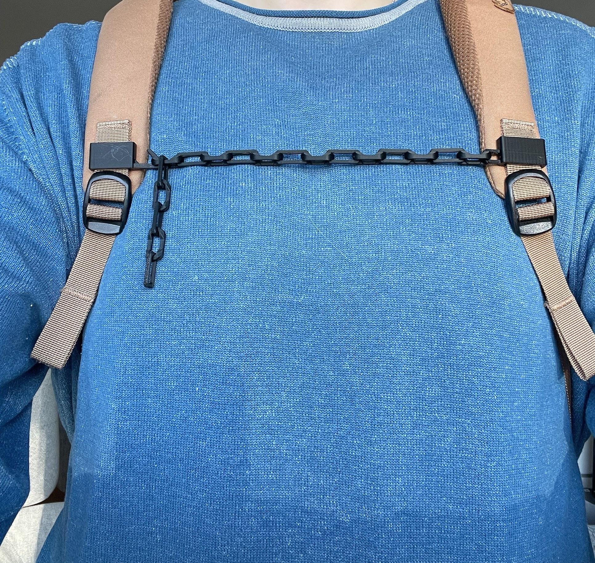
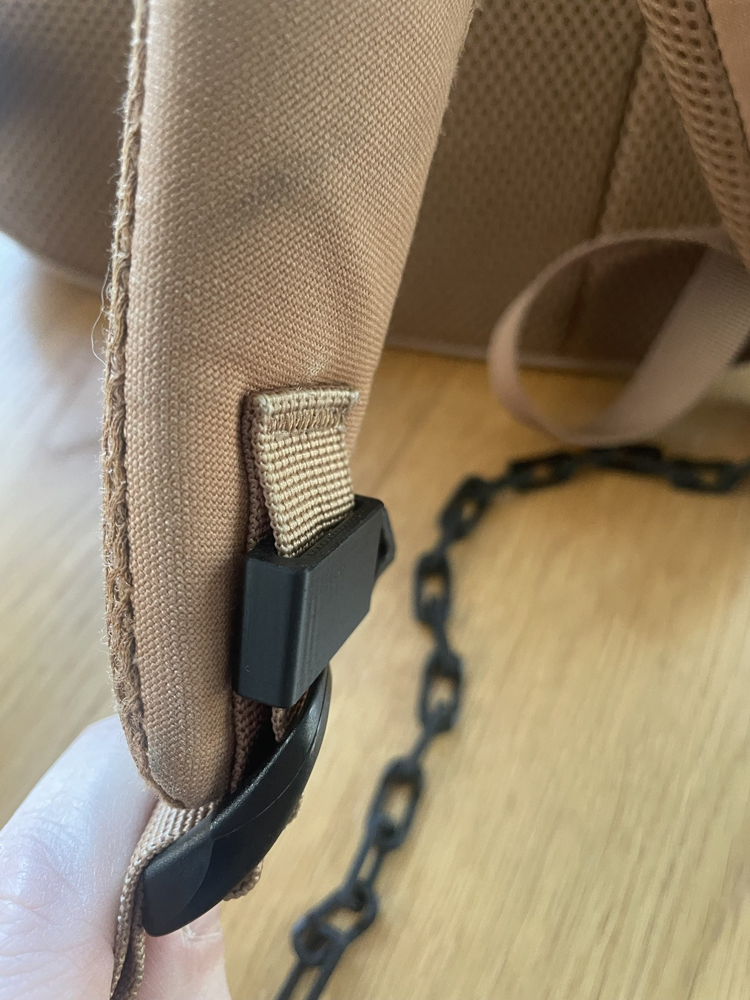
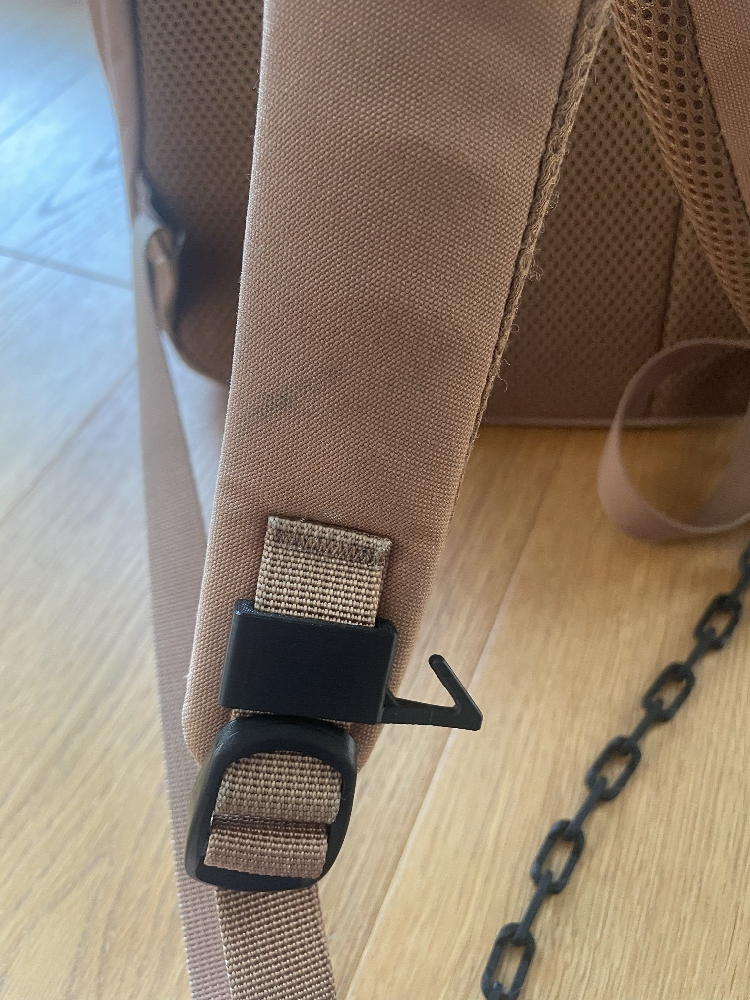
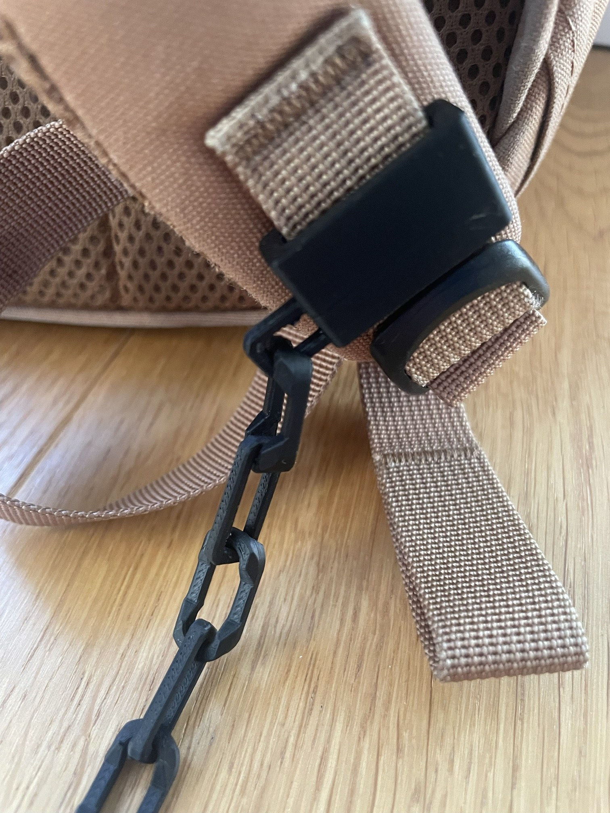

# 3D-printed backpack chest strap

A chest strap for a backpack whose shoulder straps slide off the shoulders. Two clips slide onto the 20 mm strap webbing, and a printed chain joins them. The hook on the right clip takes any link, so the length adjusts in 15 mm steps.

| | | |
|---|---|---|
|  |  |  |

More photos are in `images/result/`.

## Print it

Open `backpack-chest-strap.3mf` in Bambu Studio and print. The settings are inside: Bambu Lab P1S, 0.4 mm nozzle, PLA Basic, 0.08 mm layers, no brim, no supports.

`output/` has the two parts as STL and STEP for other slicers. Drawings with sizes are in `docs/drawings/`.

## Ideas for version 2

- **Thinner clips.** The clips look a bit thick. The walls could be thinner.
- **A hook that does not stick out.** The hook stands out from the clip. Look for a mechanism or design with nothing sticking out.
- **A place for the chain when it is not used.** The chest strap is often open, and then the chain hangs from the left clip. Ideas: a parking clip on the same shoulder strap, a parking peg on the left clip, or a chain that comes off completely.
